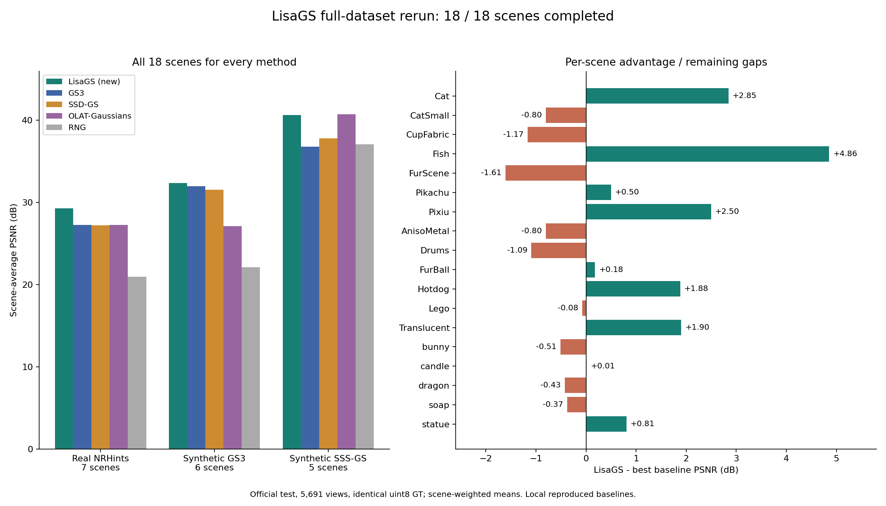

# LiSA-GS

**LiSA: Light-Space Atlases for Relightable Gaussian Splatting**

[English](#english) · [中文](#中文) · [日本語](#日本語)

> This project was produced with **Claude Opus 5.5 + Astra** (AI research/coding agents).
> It will not be submitted to a venue. Anyone is welcome to use, modify and improve it —
> no need to contact the authors.
>
> 本项目由 **Claude Opus 5.5 + Astra** 完成，不会投稿。欢迎任何人自由使用和改进，无需联系作者。
>
> 本プロジェクトは **Claude Opus 5.5 + Astra** によって作成されました。投稿予定はありません。
> どなたでも自由に利用・改良していただけます。作者への連絡は不要です。



---

## English

### What it does

LiSA-GS learns a **relightable 3D Gaussian scene** from images with known camera poses and known
point lights (OLAT-style captures), and renders it under novel views and novel point lights.

### Method (overview)

- **Light-space atlas.** From each point light's viewpoint, the 3D Gaussians are alpha-composited into
  learned flux features plus the first and second moments of normalised depth. A blur + 2× pooling pyramid
  gives a 7-level atlas (512 → 8).
- **Shading.** Every receiver point is projected into all atlas levels and samples coverage, depth offset,
  variance and moment visibility. Small networks predict a shadow correction and transport weights.
  The linear radiance is `E · (V·ρ + V0·specular + transfer)`, with `E = I / r²` the point-light irradiance,
  `ρ` an SVBRDF head, `V` moment-based visibility with a learned correction, half-vector specular lobes, and a
  learned linear combination of atlas fluxes for scattering / near-field bounces.
- **Two-stage training.** 30k steps of geometry + per-Gaussian shading (native 3DGS with densification),
  then 8k steps of per-pixel appearance refinement with frozen geometry. One recipe for all datasets.
- Rasterization uses [gsplat v1.5.3](https://github.com/nerfstudio-project/gsplat).

Details: [docs/method/principles.md](docs/method/principles.md), [docs/method/pipeline.md](docs/method/pipeline.md),
[docs/architecture/system.md](docs/architecture/system.md).

### Results (18 scenes, 5691 official test frames, single seed)

Scene-averaged PSNR↑ / SSIM↑ / LPIPS↓. Baselines were run locally with their official code and re-evaluated
against the same ground truth (not equal-budget runs).

| Method | All (18) | Real NRHints (7) | Synthetic GS³ (6) | Synthetic SSS-GS (5) |
|---|---|---|---|---|
| **LiSA-GS** | **33.47 / 0.952 / 0.056** | **29.27 / 0.909 / 0.101** | **32.39 / 0.970 / 0.038** | 40.64 / 0.990 / **0.016** |
| GS³ | 31.49 / 0.939 / 0.069 | 27.28 / 0.884 / 0.116 | 31.97 / 0.967 / 0.049 | 36.81 / 0.983 / 0.028 |
| SSD-GS | 31.59 / 0.939 / 0.068 | 27.20 / 0.882 / 0.117 | 31.53 / 0.965 / 0.050 | 37.79 / 0.986 / 0.023 |
| OLAT-Gaussians | 30.95 / 0.933 / 0.075 | 27.26 / 0.886 / 0.114 | 27.11 / 0.940 / 0.079 | **40.74 / 0.990** / 0.016 |
| RNG | 25.83 / 0.893 / 0.131 | 20.94 / 0.828 / 0.203 | 22.14 / 0.895 / 0.132 | 37.10 / 0.983 / 0.028 |

LiSA-GS wins 13/18 scenes against GS³ and 12/18 against SSD-GS and OLAT-Gaussians (PSNR). It is behind the best
baseline on FurScene, CupFabric and Drums (≈1.1–1.6 dB), and on SSS-GS scenes its PSNR/SSIM is slightly below
OLAT-Gaussians. Full per-scene tables: [docs/experiments/baseline_comparison.md](docs/experiments/baseline_comparison.md).

### Environment setup

Tested on Linux, Python 3.10, PyTorch 2.4.1, CUDA 12.1, NVIDIA RTX 6000 Ada.
You need an NVIDIA driver, Git, Conda and a CUDA-12.1-compatible C++ compiler (e.g. GCC 9–12).

```bash
git clone --recurse-submodules https://github.com/RX300/LiSA-GS.git
cd LiSA-GS

conda create -n lisags python=3.10 pip -y
conda activate lisags
conda install -c nvidia/label/cuda-12.1.0 cuda-toolkit=12.1.0 -y
export CUDA_HOME="$CONDA_PREFIX"

python -m pip install torch==2.4.1 torchvision==0.19.1 --index-url https://download.pytorch.org/whl/cu121
python -m pip install numpy==1.26.3 ninja==1.13.0 setuptools==69.5.1 wheel
bash scripts/install_backend.sh          # gsplat v1.5.3 + the GLM 0.9.9.9 revision used in the experiments
python -m pip install --no-build-isolation -e .
```

The first render compiles gsplat's CUDA extension. More checks: [docs/experiments/setup.md](docs/experiments/setup.md),
backend details: [third_party/README.md](third_party/README.md).

### Data

Download the preprocessed bundle linked in the
[SSD-GS data instructions](https://github.com/irisfreesiri/SSD-GS#-dataset-preparation) and arrange it as

```text
data/
├── Real_NRHints/Cat/
├── Synthetic_GS3/Lego/
└── Synthetic_SSS-GS/soap_small/
    ├── transforms_train.json
    ├── transforms_test.json
    ├── train/
    └── test/
```

Supported scenes are listed in [configs/staged.json](configs/staged.json); formats in [docs/data_contract.md](docs/data_contract.md).

### Train, render and evaluate

```bash
# Full recipe: 30k geometry/joint → 8k appearance → official test set
CUDA_VISIBLE_DEVICES=0 lisags-run --data-root /path/to/data --family Real_NRHints --scene Cat --output runs/cat

# Render all test views and compute PSNR / SSIM / LPIPS
CUDA_VISIBLE_DEVICES=0 lisags-evaluate runs/cat/appearance/last.pt \
  --scene /path/to/data/Real_NRHints/Cat --split test --lpips --save-all --output runs/cat_test

# All configured scenes on two GPUs
lisags-run --data-root /path/to/data --gpus 0 1 --output runs/full_dataset
```

### Code layout

```text
lisags/data/        dataset decoding and metadata
lisags/geometry/    3D Gaussian state, cameras, densification
lisags/rendering/   camera / light rasterization and receivers
lisags/models/      LiSA atlas, neural material, light transport
lisags/training/    training loop, initialization, stage schedules
lisags/evaluation/  metrics and evaluation CLI
lisags/cli/         two-stage orchestration
configs/            final training recipe
third_party/gsplat  pinned gsplat v1.5.3 (git submodule)
docs/               method, architecture and experiment records (mostly Chinese)
```

### License and acknowledgements

LiSA-GS code is released under the [MIT License](LICENSE). It uses
[gsplat](https://github.com/nerfstudio-project/gsplat) (Apache-2.0) for differentiable rasterization — please cite it:

```bibtex
@article{ye2025gsplat,
  title={gsplat: An open-source library for Gaussian splatting},
  author={Ye, Vickie and Li, Ruilong and Kerr, Justin and Turkulainen, Matias and Yi, Brent and Pan, Zhuoyang and Seiskari, Otto and Ye, Jianbo and Hu, Jeffrey and Tancik, Matthew and Angjoo Kanazawa},
  journal={Journal of Machine Learning Research},
  volume={26}, number={34}, pages={1--17}, year={2025}
}
```

Datasets come from NRHints, GS³ and SSS-GS (via the SSD-GS bundle) and follow their own licenses.

---

## 中文

### 简介

LiSA-GS 从**已知相机位姿和点光源**的多视角图像（OLAT 式采集）中学习**可重光照的 3D 高斯场景**，可在新视角、新点光源下渲染。

### 方法概要

- **光空间图集（Light-space atlas）**：从每个点光源视角对 3D 高斯做 alpha 合成，得到可学习的通量特征以及归一化深度的一阶、二阶矩；
  再经模糊和 2 倍池化构成 7 层图集（512 → 8）。
- **着色**：每个接收点投影到所有图集层，采样覆盖率、深度偏差、方差与矩可见性，由小网络预测阴影修正和传输权重。
  线性辐射为 `E · (V·ρ + V0·specular + transfer)`：`E = I / r²` 为点光源照度，`ρ` 为 SVBRDF 头，`V` 为矩可见性加学习修正，
  高光为半向量 lobes，`transfer` 为多层通量的线性组合，用于表示散射与近场反弹。
- **两阶段训练**：30k 步几何 + 逐高斯着色（原生 3DGS 及增密），之后冻结几何做 8k 步逐像素外观精修。所有数据集使用同一配置。
- 光栅化基于 [gsplat v1.5.3](https://github.com/nerfstudio-project/gsplat)。

详见 [原理](docs/method/principles.md)、[流程](docs/method/pipeline.md)、[架构](docs/architecture/system.md)。

### 性能（18 个场景、5691 张官方测试图、单种子）

场景平均 PSNR / SSIM / LPIPS 见上方 [English](#english) 表格。要点：

- 全部 18 场景：**33.47 / 0.952 / 0.056**，最佳基线 SSD-GS 为 31.59 / 0.939 / 0.068（+1.9 dB）。
- Real NRHints：29.27（GS³ 27.28）；Synthetic GS³：32.39（GS³ 31.97）；Synthetic SSS-GS：40.64（OLAT-Gaussians 40.74，略低）。
- 逐场景 PSNR 胜场：对 GS³ 13/18，对 SSD-GS、OLAT-Gaussians 各 12/18；在 FurScene、CupFabric、Drums 上落后最佳基线约 1.1–1.6 dB。
- 基线为本地使用官方代码运行并在相同 GT 上重评价，非严格等预算比较。

### 环境配置

见上方 [English → Environment setup](#environment-setup)（Linux、Python 3.10、PyTorch 2.4.1、CUDA 12.1）：
创建 conda 环境 → 安装 CUDA 12.1 toolkit 与 PyTorch → 运行 `bash scripts/install_backend.sh`（固定 gsplat v1.5.3 与实验所用 GLM 版本）→ `pip install -e .`。
数据使用 [SSD-GS](https://github.com/irisfreesiri/SSD-GS#-dataset-preparation) 提供的预处理数据包。训练/评测命令为 `lisags-run` 与 `lisags-evaluate`。

### 许可

代码采用 [MIT License](LICENSE)；gsplat 为 Apache-2.0。数据集遵循各自许可。

---

## 日本語

### 概要

LiSA-GS は、**カメラ姿勢と点光源が既知**の多視点画像（OLAT 型撮影）から**リライティング可能な 3D ガウシアンシーン**を学習し、
新しい視点・新しい点光源の下でレンダリングします。

### 手法の概要

- **ライト空間アトラス**：各点光源の視点から 3D ガウシアンをアルファ合成し、学習可能なフラックス特徴と正規化深度の 1 次・2 次モーメントを得る。
  ぼかし＋2 倍プーリングで 7 階層のアトラス（512 → 8）を構成する。
- **シェーディング**：各受光点を全階層に投影し、被覆率・深度差・分散・モーメント可視性をサンプリングし、小さなネットワークで影の補正と輸送重みを予測する。
  線形放射輝度は `E · (V·ρ + V0·specular + transfer)`（`E = I / r²`、`ρ` は SVBRDF ヘッド、`V` は学習補正付きモーメント可視性、
  ハーフベクトル鏡面ローブ、`transfer` は散乱・近距離反射を表すフラックスの線形結合）。
- **2 段階学習**：30k ステップで幾何＋ガウシアンごとのシェーディング（ネイティブ 3DGS と densification）、その後幾何を固定して 8k ステップのピクセル単位外観リファイン。全データセットで同一設定。
- ラスタライズは [gsplat v1.5.3](https://github.com/nerfstudio-project/gsplat) を使用。

詳細は [原理](docs/method/principles.md)、[パイプライン](docs/method/pipeline.md)、[アーキテクチャ](docs/architecture/system.md)（中国語）を参照。

### 性能（18 シーン、公式テスト 5691 枚、単一シード）

表は [English](#english) を参照。要点：

- 全 18 シーン：**33.47 / 0.952 / 0.056**（最良ベースライン SSD-GS 31.59 / 0.939 / 0.068 に対し +1.9 dB）。
- Real NRHints 29.27（GS³ 27.28）、Synthetic GS³ 32.39（GS³ 31.97）、Synthetic SSS-GS 40.64（OLAT-Gaussians 40.74 にやや劣る）。
- シーン別 PSNR の勝数：GS³ に 13/18、SSD-GS・OLAT-Gaussians に各 12/18。FurScene、CupFabric、Drums では最良ベースラインに約 1.1〜1.6 dB 劣る。
- ベースラインは公式コードをローカルで実行し同一 GT で再評価したもの（厳密な同一計算予算の比較ではない）。

### 環境構築

[English → Environment setup](#environment-setup) を参照（Linux、Python 3.10、PyTorch 2.4.1、CUDA 12.1）：
conda 環境作成 → CUDA 12.1 toolkit と PyTorch のインストール → `bash scripts/install_backend.sh`（gsplat v1.5.3 と実験時の GLM を固定）→ `pip install -e .`。
データは [SSD-GS](https://github.com/irisfreesiri/SSD-GS#-dataset-preparation) の前処理済みパッケージを使用。学習・評価は `lisags-run` と `lisags-evaluate`。

### ライセンス

コードは [MIT License](LICENSE)、gsplat は Apache-2.0。データセットはそれぞれのライセンスに従います。
